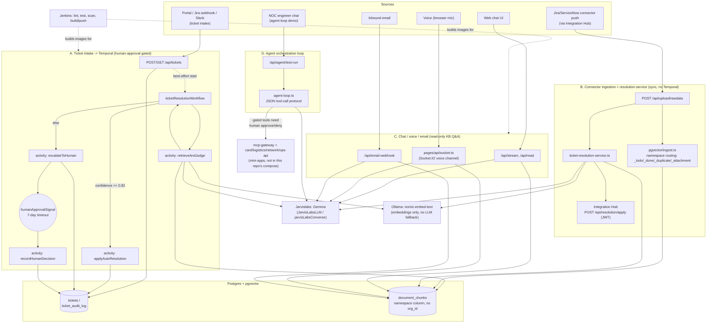

# Ticketly — Architecture

## Why pgvector over a graph DB

The core job is: given a new ticket's free-text description, retrieve the most
*semantically relevant* knowledge-base articles and past resolved tickets, then
let Gemma reason over that context to answer questions or draft a resolution.
That's retrieval-augmented generation over unstructured text — a similarity
search problem, not a relationship-traversal problem. `pgvector` on the
Postgres we already need (for tickets/audit) gives us that with zero extra
infra. A graph DB (Neo4j) would only earn its place if we needed explicit
relationship queries (asset dependency chains, org charts) — out of scope for
now, so it's cut.

## Flow

Reality check first: there is no single unified pipeline. Four largely
independent surfaces share the same Postgres/pgvector store and the same
Jarvislabs/Gemma endpoint, but they are wired together only at that storage
layer, not through one orchestrator:

- **(A) Ticket intake → Temporal**, gated on human approval for anything
  below the confidence bar.
- **(B) Connector-driven document ingestion + resolution lookup**, triggered
  by an external Integration Hub push, entirely synchronous, no Temporal
  involved.
- **(C) Multi-channel knowledge-base Q&A** (web chat, voice, email) — read
  only, never creates or auto-resolves a ticket.
- **(D) A separate agent-orchestration demo** (NOC tool-calling assistant)
  that reuses the Jarvislabs model and a human-approval gate, but has nothing
  to do with ticket resolution.

## Component notes

- **Next.js (`my-app`)** — hosts all four surfaces above: the ticket-intake
  API, the connector/document-ingestion API, the chat/voice/email front
  doors, and the agent-loop test harness. No OpenUI generative-UI layer
  exists in the code; that part of the original design never got built.

- **(A) Temporal + `ticketResolutionWorkflow`** (`lib/temporal/workflows.ts`,
  `lib/temporal/activities.ts`) — the one piece of durable orchestration that
  actually exists. `app/api/tickets/route.ts` persists the ticket (and a
  `ticket_audit_log` row) to Postgres first, then best-effort starts the
  workflow by name (`startTicketResolutionWorkflow` in
  `lib/temporal/client.ts`) — a Temporal outage delays resolution, it never
  loses the ticket. The workflow has one combined activity,
  `retrieveAndJudge`, not separate "retrieve" and "judge" steps: it embeds
  the ticket and calls `queryPineconeForTicketResolution` (same pgvector
  query function path B uses), which is already one round trip to the store
  and to Jarvislabs. Confidence `>= 0.82` auto-resolves
  (`applyAutoResolution`); otherwise the workflow escalates
  (`escalateToHuman`) and blocks on `humanApprovalSignal` for up to 7 days
  before `recordHumanDecision` runs. `scripts/temporal-worker.ts`
  (`pnpm worker:temporal`) is the only process that executes any of this —
  without it running, tickets just sit queued on the `ticket-resolution`
  task queue.

- **(B) Connector ingestion + `ticket-resolution-service.ts`** — a
  completely separate, synchronous path with no Temporal involvement, hit by
  `app/api/upload/rawdata/route.ts` when an external connector (via an
  "Integration Hub", JWT-authenticated) pushes a Jira/ServiceNow ticket plus
  attachments. `lib/documents/jira-preprocess.ts` and
  `lib/documents/normalized-document-processor.ts` handle attachment
  extraction (S3/PDF/OCR) and status/namespace bookkeeping, then
  `lib/pgvector/ingest.ts` writes/moves chunks between per-project
  `_todo`/`_done`/`_duplicate`/`_attachment` namespaces in `document_chunks`.
  `handleNewTicketResolution`/`handleNewTicketResolutionNormalized` search
  org-wide for a duplicate or a past resolution (again via
  `queryPineconeForTicketResolution`) and, on a confident match, call
  `lib/jira-integration-service.ts`. Despite the name, that service doesn't
  talk to the Jira REST API — it POSTs to
  `${INTEGRATION_HUB_URL}/api/resolution/apply` with a JWT
  (`lib/jwt-service.ts`) and expects the Hub to apply the resolution/duplicate
  flag back in Jira. The `JIRA_BASE_URL`/`JIRA_EMAIL`/`JIRA_API_TOKEN`
  env vars still wired into `docker-compose.yml` are currently unused by any
  code. This path and path A are not unified: they share the pgvector store
  and the judgement function, but a ticket going through one has no relation
  to the `tickets` table the other owns.

- **(C) Chat / voice / email channels** — all three are read-only KB Q&A,
  none of them create or resolve a ticket. The web chat UI goes through
  `/api/stream` and `/api/read`; the voice channel is a Socket.IO server
  (`pages/api/socket.ts`) that does AssemblyAI streaming STT, then local
  Piper TTS (falling back to browser TTS on failure); inbound email
  (`/api/email-webhook` → `lib/email-processor.ts`) answers and replies via
  `lib/email-service.ts`. All three call the same `queryChatAndAnswer`
  (`lib/pgvector/query.ts`): embed the query, search pgvector namespaces,
  assemble a prev/current/next chunk window, ask Jarvislabs, and apply a
  hallucinated-vendor-term guard before returning the answer.

- **(D) Agent orchestration loop** (`lib/agent-loop.ts`, exposed via
  `app/api/agent/test-run/route.ts`) — unrelated to ticket resolution. A
  single NOC-assistant scenario (`interface-flapping`) drives a prompted
  JSON tool-call protocol (not native tool-use — the underlying model didn't
  support it) against a live MCP gateway. `GATED_TOOLS` (e.g.
  `network_soft_clear_interface`, `ops_rollback_deployment`) are hard-coded
  so the model itself can never set `approved: true`; a pending gated call
  comes back to the caller for an explicit human approve/deny before the
  loop resumes.

- **Postgres + pgvector** — `tickets`/`ticket_audit_log` (path A's state)
  and `document_chunks` (`namespace` column — path B's per-project
  `_todo`/`_done`/`_duplicate`/`_attachment` values, path C's free-form
  namespaces) are the only tables anything actually queries.
  `docker/postgres/init.sql` still defines `knowledge_base_chunks` and
  `resolved_tickets` from the original design; nothing in the code reads or
  writes them anymore — they're dead schema, not wired into any path above.

- **Jarvislabs / Gemma** (`lib/jarvislabs/client.ts`) — the *only* place any
  judgement, drafting, or tool-calling reasoning happens now. It's an
  OpenAI-SDK client against Jarvislabs' OpenAI-compatible endpoint serving
  `gemma-4-31b-it`. There is no local-Ollama fallback for generation
  anymore — `JarvisLabsLLM.invoke` throws if `JARVISLABS_API_KEY` isn't set.
  Ollama is still running locally, but only for `nomic-embed-text`
  embeddings (`lib/pgvector/embeddings.ts`); it never serves Gemma itself in
  this codebase today.

- **mini-apps** (`mini-apps/card-api`, `logistics-api`, `network-api`,
  `ops-api`, `mcp-gateway`) — self-contained services carried over from
  `platform-nexagrid` as-is (each with its own `package.json` and Prisma
  schema). `mcp-gateway` is what path D's agent loop actually calls over
  streamable-HTTP MCP; the other four are the tool backends it fronts. None
  of the five are started by this repo's root `docker-compose.yml` or
  referenced by the Temporal workflow — they exist in the tree and work
  standalone, but aren't integrated into Ticketly's own infra yet.

- **Jenkins** — CI gate: lint, unit tests, security scan, then build/push the
  app + worker images that Compose/K8s pulls. Unchanged from the original
  design.

- **Kepler** — still just a forward-looking design note, not real code: no
  file in this repo references Kepler or an energy/cost budget guard. Keep
  it here as an intended future gate on path A, not as something implemented.

### Known gaps, stated plainly

- **No tenant isolation in pgvector.** `document_chunks` has no `org_id`
  column. `queryPineconeForTicketResolution` accepts an `orgId` parameter
  (path B passes one) but the actual SQL only filters by `namespace`, not by
  org — the original Pinecone design's namespace-per-org isolation hasn't
  been rebuilt on top of pgvector yet.
- **Path A's activities never leave Postgres.** `applyAutoResolution`,
  `escalateToHuman`, and `recordHumanDecision` only update `tickets`/
  `ticket_audit_log`. There's no Jira ticket update or human notification
  fired from the Temporal path itself — that only happens in path B, via
  `ticket-resolution-service.ts` → Integration Hub, which is a different
  ticket population entirely.
- **Paths A and B are genuinely separate**, not two entry points into one
  pipeline. They call the same `queryPineconeForTicketResolution` function
  and read/write the same `document_chunks` table, but nothing currently
  links a Temporal-run ticket to a connector-pushed one.
- **mini-apps are present but not integrated** — real, working services, but
  not part of this project's docker-compose, environment wiring, or the
  ticket-resolution workflow.
