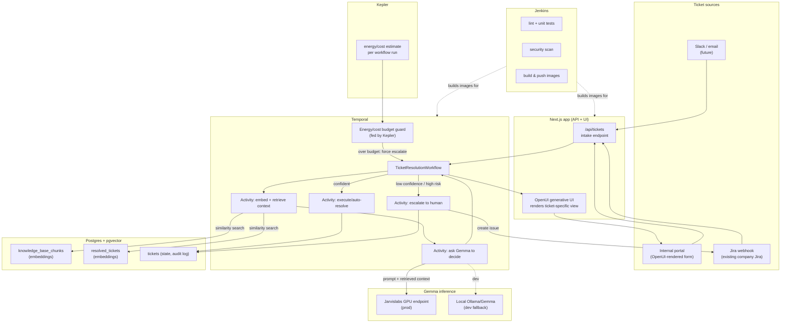

# Ticketly — Architecture

## Why pgvector over a graph DB

The core job is: given a new ticket's free-text description, retrieve the most
*semantically relevant* knowledge-base articles and past resolved tickets, then
let Gemma reason over that context to answer questions or draft a resolution.
That's retrieval-augmented generation over unstructured text — a similarity
search problem, not a relationship-traversal problem. `pgvector` on the
Postgres we already need (for tickets/audit) gives us that with zero extra
infra. A graph DB (Neo4j) would only earn its place if we needed explicit
relationship queries (asset dependency chains, org charts) — out of scope for
now, so it's cut.

## Flow

## Component notes

- **Next.js (`my-app`)** — ticket intake API + OpenUI-rendered front end. One
  component library, Gemma's decision picks which components to render per
  ticket type (bounded output space, not free-form generated code).
- **Temporal** — durable workflow per ticket. Retries, timeouts, and a
  `HumanApprovalSignal` for anything destructive or low-confidence. Crash a
  worker mid-run, it resumes from the last completed activity.
- **Postgres + pgvector** — single source of truth: `tickets` (state + full
  audit trail), `knowledge_base_chunks` and `resolved_tickets` (both with
  `vector` columns for embedding similarity search).
- **Gemma** — self-hosted (Jarvislabs GPU in prod, local Ollama for dev/demo)
  so ticket content never leaves our infra. Used for: classification, RAG
  answer drafting, and picking the next workflow action / UI shape.
- **Jira integration** — not the primary queue; it's the escalation path.
  When Temporal's workflow decides a ticket is too complex/risky to
  auto-resolve, it files a Jira issue (via Jira REST API) for a human,
  with the retrieved context attached so the human isn't starting cold.
- **Jenkins** — CI gate: lint, unit tests, security scan, then build/push the
  app + worker images that Compose/K8s pulls.
- **Kepler** — energy/cost estimate per workflow run, enforced as a budget
  guard: a ticket whose Gemma re-planning loop blows past budget gets forced
  into human escalation instead of spinning silently.
